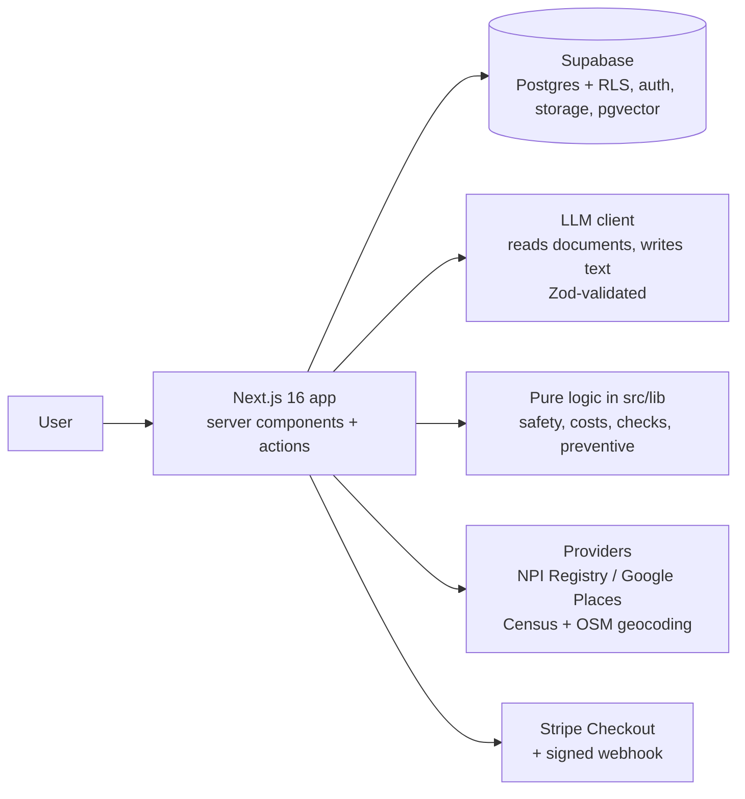

<div align="center">

# 🩺 Recheck

**Stop overpaying for healthcare. Recheck tells insured American families where to go for care, who is nearby and what they will likely pay under their own plan. After the visit, it checks the bill for errors and drafts the dispute letter.**

Business Cup 2.0 · B2C · web

[**▶ Live app**](https://business-cup-production.up.railway.app) ·
[Demo script](recheck/docs/DEMO.md) · [Product](recheck/docs/PROJECT.md) · [Structure](recheck/docs/STRUCTURE.md) · [Plan](recheck/docs/PLAN.md)

**No sign-up needed:** on the landing page click **Explore the demo — no sign-up**. It opens Michael's account (San Francisco, UnitedHealthcare PPO, Recheck Plus). The account is shared with other visitors.

</div>

---

## Results at a glance

| | Result | How |
|---|---|---|
| 🧮 **Prices** | real CMS Medicare Physician Fee Schedule 2026, by CPT code | each price links to its source; the commercial markup comes from KFF and is labeled as an assumption |
| 💵 **Your share** | a range computed in code from your own plan | copay, remaining deductible, coinsurance, capped at the out-of-pocket max; money is integer cents |
| 🚑 **Urgency** | fixed rule set, never the LLM | `src/lib/care/safety.ts`; any warning sign shows only **Get care now** |
| 🏥 **Providers** | real directory records (CMS NPI Registry, optional Google Places) | every result shows its source and "Insurance: not verified"; no fake data when a search fails |
| 🧾 **Bill checks** | 5 code checks, every flag points to a line item | duplicates, bill vs EOB mismatch, billed before insurance paid, unclear lines, totals that don't add up |
| 🛡️ **Preventive care** | USPSTF grade A/B and CDC adult schedule | who it applies to and when it is due is decided in code |
| 📚 **Ask Recheck** | answers only from 30 official documents, with links | pgvector retrieval; links come from the database, not the model; "I don't know" when the documents don't answer |
| 🌐 **Languages** | English, Russian, Kazakh | full UI dictionaries |
| ✅ **Tests** | **278 passed** in 38 files | `npm run typecheck && npm run lint && npm test` |

## How it works for the user

1. **Onboarding.** Name, ZIP code and insurance: deductible and how much is met, out-of-pocket max, coinsurance, copays. Every field can be skipped.
2. **Free preventive care.** With birth year and sex, Recheck lists the screenings and vaccines most plans cover at $0 in-network, each with its official source, and shows what is due.
3. **Describe the problem**, e.g. "my knee has hurt for a week after tennis". The AI summarizes it, then fixed safety questions check for warning signs.
4. **Care options.** Primary care, sports medicine or urgent care, each with three cost scenarios: visit only, visit + X-ray, visit + MRI.
5. **Providers nearby** with distance, phone and a ready email. You book with the clinic yourself and save the date; Recheck adds it to your home page and a calendar file.
6. **After the visit** Recheck asks for the bill. Upload the bill and the EOB, see the flags, get a dispute letter and a phone script.
7. **Ask Recheck** about insurance, bills or preventive care.

**Recheck Plus, $9.99 a month.** Free: onboarding, preventive care, booking, the first care question, the first bill check and the first Ask question. Paid: everything after that, letters and the yearly picture. Safety guidance is never behind the paywall. Stripe runs in test mode: card `4242 4242 4242 4242`, any future date, any CVC.

## Architecture



**Main principle: the LLM reads and writes, code decides.** The model never does arithmetic, never decides what is an error and never decides urgency. Every structured output is validated with Zod; invalid output marks the document `needs_review` instead of crashing.

## Repository structure

```text
recheck/
  src/app/            pages and server actions (landing, onboarding, home, care, visits, ask, billing, profile)
  src/components/     UI components
  src/lib/care/       safety rules and care routes
  src/lib/costs/      CMS benchmarks, your share, scenarios
  src/lib/checks/     the five bill checks
  src/lib/providers/  NPI Registry, Google Places, geocoding, distances
  src/lib/preventive/ USPSTF and CDC rules
  src/lib/knowledge/  document chunking and answer checks for Ask
  src/lib/llm/        the only LLM client
  src/lib/billing/    Stripe and plan access
  src/lib/i18n/       English, Russian, Kazakh
  knowledge/          30 official source documents for Ask
  supabase/migrations SQL schema with row-level security
  fixtures/           sample documents, used only by tests and scripts
  tests/              Vitest unit tests
  docs/               product, structure, rules, plan, demo script
```

## Tech

| Layer | What we use |
|---|---|
| App | Next.js 16 (App Router), React, TypeScript strict, Tailwind v4 |
| Data | Supabase: Postgres with RLS on every table, email auth, private storage, pgvector |
| AI | LLM through `src/lib/llm/client.ts`, embeddings `text-embedding-3-small`, Zod validation |
| Payments | Stripe Checkout + signed webhook (test mode) |
| Public data | CMS Physician Fee Schedule, CMS NPI Registry, USPSTF, CDC, HealthCare.gov, DOL, California DMHC, US Census geocoder, OpenStreetMap Nominatim |
| Quality | Vitest, ESLint, typecheck before every commit |
| Hosting | Railway, auto-deploy from `main` |

## Run locally

```bash
cd recheck
npm ci
cp .env.example .env.local   # Supabase, LLM and Stripe test keys
npm run dev
```

Apply the SQL files in `recheck/supabase/migrations/` in order, then load the Ask knowledge base with `npm run build:knowledge`. `GOOGLE_PLACES_API_KEY` is optional: without it, provider search uses the free NPI Registry. `DEMO_EMAIL` is optional and enables the one-click demo.

```bash
npm run typecheck && npm run lint && npm test
```

More detail: [recheck/README.md](recheck/README.md).

Recheck explains costs and bills. It does not give legal or medical advice. Keys live only in environment variables; no secrets or medical data are in the repository.
